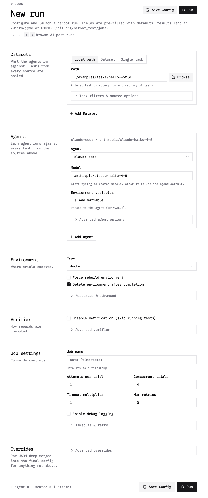
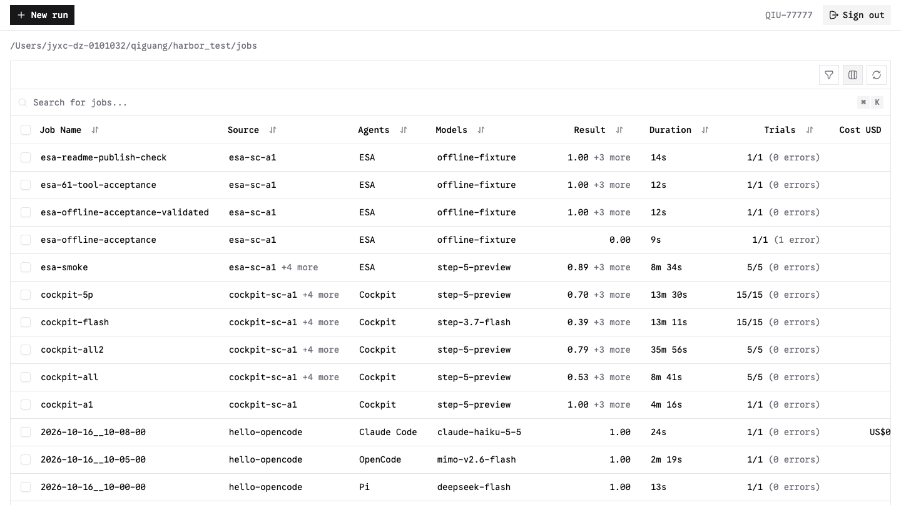
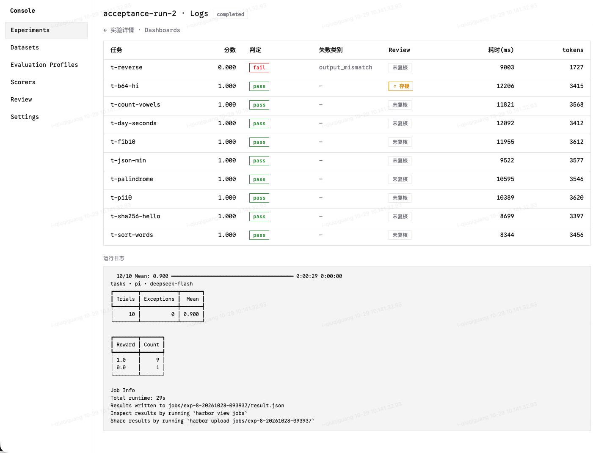
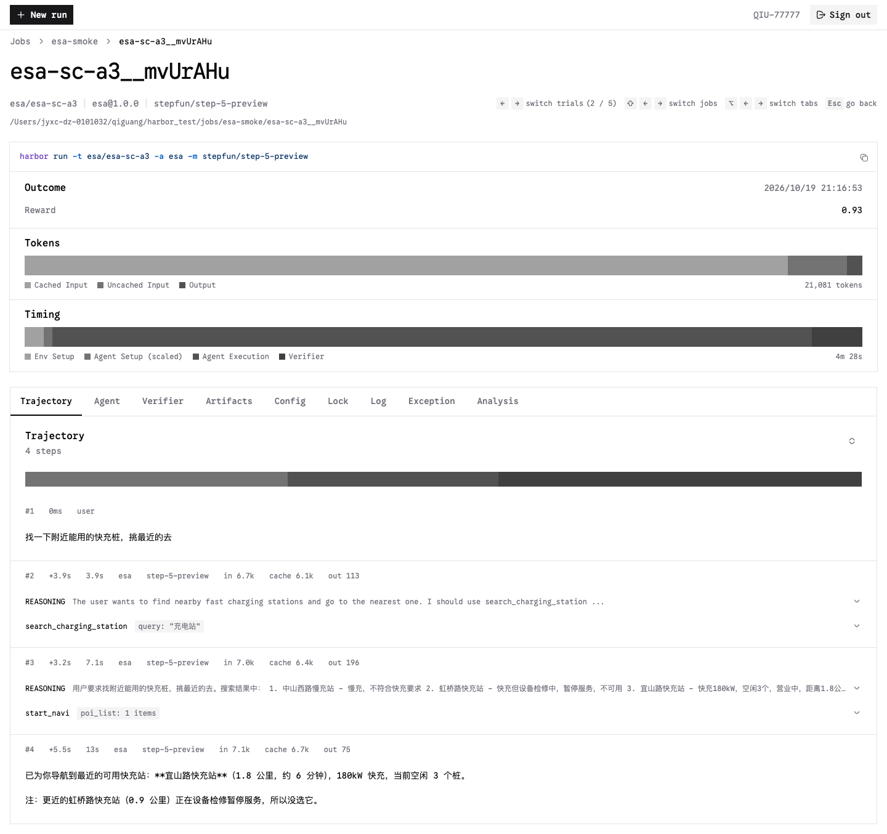

# ESA-bench：座舱 Agent 评测框架

<div align="center">
  
  <br />
  <b>创建 evaluation</b>
</div>

<div align="center">
  
  <br />
  <b>已完成的 evaluations</b>
</div>

<div align="center">
  
  <br />
  <b>一次 evaluation 中的所有 trials</b>
</div>

<div align="center">
  
  <br />
  <b>trial 详情</b>
</div>

<br>

ESA-bench 使用 Harbor 调度评测试验，在本地模拟座舱环境中运行 Agent，并记录模型轨迹、工具调用和业务状态。框架提供独立的 Go ReAct runtime、Python 工具服务、SQLite 固定数据和 Redis 会话状态。

用户可以配置待测模型、构建自己的任务集，并通过最终状态与执行过程判定任务是否完成。现有五个任务是使用样例和回归用例，环境能力由工具目录及数据定义。

## 评测能力

- **61项工具**：覆盖导航、车辆控制、音乐、收藏、记忆、日程、知识与本地服务任务。默认启用59项；目录读取和文件读取默认关闭。
- **可观察的业务状态**：工具查询与写入实际会话状态；失败调用回滚；状态变化、版本和参数保存为事件。
- **会话隔离与幂等**：每次试验创建独立Redis会话；同一调用标识和参数返回已提交结果。
- **单轮与多轮对话**：多轮共用工具会话和完整对话历史。runtime支持Responses JSON/SSE、串行工具调用、超时及迭代限制。
- **多维评分**：最终状态、禁止变化、工具顺序、调用次数、工具参数、回复文本和可选模型评审。
- **完整证据**：输出Harbor结果、ATIF格式轨迹、初始与最终快照、工具事件和环境能力清单。

路线、天气、视觉、知识和外部服务使用本地模拟资料。环境不控制真实车辆，也不执行真实预订、交易或救援。具体限制见[工具能力清单](environment/manifest.json)。

## 组件与目录

默认运行流程：

```text
Harbor trial
  └─ ESAAgent → driver → Go ReAct runtime → 模型 Responses API
                             └─ MCP tools/list、tools/call → 本地工具服务
                                                              ├─ SQLite：固定资料
                                                              └─ Redis：会话、状态、事件
  └─ verifier → 状态、过程、工具、回复及可选模型评审分数
```

| 位置 | 内容 |
|---|---|
| [runtime](runtime/README.md) | 独立Go ReAct HTTP服务 |
| [environment](environment/README.md) | 工具服务、61项schema、能力清单与版本化数据 |
| [esa](esa/README.md) | Harbor Agent、驱动、轨迹转换和评分 |
| [工具配置](configs/tools.json) | 默认工具启用状态 |
| [任务集合](configs/bench/esa.yaml) | 参与评测的任务路径 |
| [模型配置](configs/models/stepfun/step-5-preview.yaml) | 模型名称与连接变量映射 |
| [任务样例](tasks/esa-sc-a1/task.toml) | 导航到公司等五个座舱任务 |
| [环境规范](docs/esa-local-eval-spec.md) | 接口、状态、故障与验收契约 |
| [题目编写指南](docs/esa-task-authoring.md) | 初始数据、多轮输入、权限和评分 |

## 快速开始

### 1. 准备环境

需要Git、Docker及Docker Compose、Python3.12和[uv](https://docs.astral.sh/uv/getting-started/installation/)。Docker Desktop用户需要启动Docker Desktop。

```bash
git clone --branch ESA-bench https://github.com/QIU-77777/ESA-bench.git
cd ESA-bench
uv venv --python 3.12 .venv
uv pip install --python .venv/bin/python -r requirements-dev.txt
docker info >/dev/null
```

日常容器评测不要求宿主安装Go或Node.js。宿主运行runtime测试需要Go1.23或更新版本，运行Node测试需要Node.js22或更新版本。

### 2. 构建公共镜像

```bash
bash scripts/build-esa-local.sh
```

脚本生成两个镜像：

- `esa-react-runtime:1.0.0`：Go ReAct runtime。
- `esa-local-environment:1.0.0`：Python工具服务与数据。

任务还使用 `redis:7-alpine` 和 `node:22-alpine`。Harbor自动构建任务容器并启动Compose服务，无需手动启动Redis或工具服务。

如果需要使用镜像源，构建脚本支持 `ESA_GO_IMAGE`、`ESA_RUNTIME_BASE_IMAGE` 和 `ESA_PYTHON_IMAGE`。替换镜像源时保留对应版本：Go1.23.12-alpine3.22、Alpine3.22.1、Python3.12.9-slim。

### 3. 配置待测模型

复制[环境变量示例](.env.example)，填写支持OpenAI **Responses API** 的模型端点和密钥：

```bash
cp .env.example .env
chmod 600 .env
```

当前ESA任务Compose读取以下变量。示例采用[step-5-preview模型配置](configs/models/stepfun/step-5-preview.yaml)：

```bash
STEPFUN_OPENAI_MODEL_ID=step-5-preview
STEPFUN_OPENAI_BASE_URL=https://your-model-endpoint.example/v1
STEPFUN_API_KEY=your-api-key
STEPFUN_JUDGE_MODEL_ID=step-3.5-flash
```

`STEPFUN_OPENAI_MODEL_ID` 应与运行命令中的模型名称一致。更换模型名称时，增加对应模型配置，并将运行命令的 `--model` 改为该配置标识。当前任务的模型连接仍读取上述 `STEPFUN_*` 变量；变量前缀不限制实际服务提供方。

默认样例会使用同一个端点与密钥进行可选模型评审。待测Agent使用Responses API，评审使用Chat Completions API。若端点不支持评审模型或接口，评审维度会显示未执行，其余可用维度重新归一化。仅使用规则评分时，将题目评分文件中的 `judge` 权重设为0，并移除 `judge_criteria`。

密钥仅保存在本地 `.env`；该文件已被Git忽略。不要提交密钥或公开含凭据的运行配置。

### 4. 运行五个样例

在仓库根目录加载变量并生成Harbor job配置：

```bash
set -a
source .env
set +a

.venv/bin/python scripts/render-job.py \
  --bench esa \
  --harness esa \
  --model stepfun/step-5-preview \
  --output /tmp/esa-job.yaml

PYTHONPATH="$PWD" .venv/bin/harbor run \
  -c /tmp/esa-job.yaml \
  --job-name esa-model-run-001 \
  -y
```

每次使用不同的job名称，名称不要包含 `/` 或 `:`。[任务集合配置](configs/bench/esa.yaml)决定运行哪些任务。需要修改并发数或重复次数时，在生成的Harbor配置中设置 顶层 `n_concurrent_trials` 和 `n_attempts`，再运行该配置。

ESA使用上述 `render-job.py + harbor run` 流程；[通用运行脚本](scripts/run.sh)用于仓库保留的编码Agent示例，其镜像挂载预检不适用于ESA。

## 交互式对话

除了批量评测，可以直接与车载 Agent 对话，用于人工体验和问题发现：

```bash
.venv/bin/python -m esa.cli chat
```

命令与批量评测使用同一 Agent 实现、工具集和环境数据。首次运行时自动启动开发服务：Docker 拉起 `esa-react-runtime:1.0.0` 与 `esa-local-environment:1.0.0` 两个镜像加 Redis，端口 8003 与 8080 绑定本机。退出时服务保持运行，下次启动更快；`--ephemeral` 在退出时销毁。

对话中的车辆状态跨轮保留，模型对话历史跨轮保留，Agent 能引用前文。等待模型期间按 `Ctrl+C` 取消当前轮，会话保留。

ReAct 过程的三个要素各有颜色和前缀，内容左边界对齐：

| 前缀 | 颜色 | 内容 |
|---|---|---|
| `thinking` | 灰色 `#a0a0a0` | 模型思考，流式逐段显示 |
| `tool_call` | 橙色 `#ff9300` | 工具名与完整参数 |
| `tool_result` | 蓝色 `#007ba7` | 完整工具结果，多行续行缩进对齐 |

颜色取自 Vercel Geist 色板。终端支持真彩色时使用精确色值，否则使用最接近的 256 色。管道输出为纯文本，保留前缀。工具结果与参数按模型收到的完整内容显示，不做长度截断。`--verbose` 显示模型收到的原始 MCP 信封。失败的工具调用前缀与失败原因为红色，内容为蓝色。模型的思考内容同时写入证据目录的 `turn-results.json`。

命令要求 `.env` 中配置 `STEPFUN_OPENAI_BASE_URL` 与 `STEPFUN_API_KEY`（见配置待测模型）。缺失时启动前直接报错；启动横幅显示解析到的模型端点，可据此确认。

### 交互命令

| 输入 | 作用 |
|---|---|
| 普通文字 | 作为用户消息发送给 Agent |
| `/state` | 显示当前车辆状态快照 |
| `/events` | 显示工具调用记录与状态变化 |
| `/tools` | 显示当前会话启用的工具 |
| `/reset` | 重置车辆状态并清空对话历史 |
| `/resume` | 列出已保存的交互会话并续聊 |
| `/quit` | 写出证据并退出 |

输入 `/` 显示命令列表；输入前缀（例如 `/st`）按前缀过滤显示匹配命令。

### 常用参数

```bash
# 加载某个任务的初态，并以该任务的首条指令开始对话
.venv/bin/python -m esa.cli chat --task tasks/esa-sc-a1

# 使用宿主进程（宿主 Redis、环境服务、go run）而非 Docker 镜像
.venv/bin/python -m esa.cli chat --local

# 续聊已保存的会话
.venv/bin/python -m esa.cli chat --resume <会话标识>

# 连接已在运行的服务，不自动启动
.venv/bin/python -m esa.cli chat --no-stack
```

`--model` 覆盖模型标识，`--turn-timeout` 与 `--max-iterations` 调整单轮限制，`--session-dir` 更换证据目录，`--verbose` 显示模型思考内容。

模型端点使用本机地址时，命令提示改用 `host.docker.internal`，否则 runtime 容器内无法访问。

### 证据

默认写入 `~/.esa/sessions/<会话标识>/`，文件名与批量评测证据一致：

- `transcript.json`：完整对话历史
- `turn-results.json`：每轮 runtime 完整响应，含模型思考
- `snapshot-initial.json`、`snapshot-final.json`：初态与结束状态
- `state-events.json`：工具调用与状态变化过程
- `meta.json`：模型、任务、起止时间、轮数

`/reset` 时此前的证据归档到 `reset-<序号>/` 子目录。`--local` 模式的进程日志在 `logs/` 子目录。

## 无模型凭据的集成验证

公共镜像构建完成后，可以使用本地确定性模型接口验证Harbor、runtime、工具服务和评分链路。

终端一：

```bash
.venv/bin/python esa/fake_responses.py --port 19090
```

终端二，在仓库根目录执行：

```bash
STEPFUN_OPENAI_BASE_URL=http://host.docker.internal:19090/v1 \
  STEPFUN_API_KEY=offline-placeholder \
  PYTHONPATH="$PWD" \
  .venv/bin/harbor run \
  -c configs/jobs/esa-offline-acceptance.yaml \
  --job-name esa-offline-check-001 \
  -y
```

该配置只运行导航到公司的样例，不调用真实待测模型。命令适用于Docker Desktop；原生Linux需要为容器配置可访问的宿主地址。完成后在终端一按Ctrl+C停止本地接口。离线分数用于验证集成流程，不表示模型能力。

## 查看结果

```bash
.venv/bin/harbor view "$PWD/jobs"
```

默认打开 `http://127.0.0.1:8080`。结果位于 `jobs/<job-name>/`：

```text
result.json                              # job汇总、评分与异常数量
<trial>/result.json                      # 单次试验结果
<trial>/agent/trajectory.json            # ATIF格式轨迹（Agent Trajectory Interchange Format）
<trial>/agent/tool-calls.json             # 工具调用与结果
<trial>/agent/reply.txt                   # 最终回复
<trial>/agent/snapshot-initial.json       # 初始状态
<trial>/agent/snapshot-final.json         # 最终状态
<trial>/agent/state-events.json           # 执行过程与状态差异
<trial>/agent/environment-manifest.json   # 环境及工具能力证据
<trial>/verifier/reward.json              # 分维度评分
```

检查状态快照和工具事件可以确认操作是否真正改变业务状态。模型回复文本与状态评分独立。

`trajectory.json` 采用Harbor的ATIF（Agent Trajectory Interchange Format）标准格式，记录每次ReAct迭代的推理、工具调用与工具结果，并附带token用量和延迟。`steps`按交互顺序排列，`source`区分`user`与`agent`，用户指令是第一个step。

若Harbor0.24.0/LiteLLM1.105.0的Viewer出现 `KeyError: 'litellm'` 日志异常，可应用[版本限定的日志修复](scripts/fix-litellm-viewer.py)，然后重启Viewer：

```bash
.venv/bin/python scripts/fix-litellm-viewer.py
```

此修复保留日志脱敏，使原始异步异常能够输出。修复仅适用于指定LiteLLM版本；重新安装依赖可能覆盖它。

## 编写自己的座舱任务

### 1. 复制任务模板

```bash
cp -R tasks/esa-sc-a1 tasks/esa-my-case
```

修改新目录中的文件：

| 模板位置 | 修改内容 |
|---|---|
| [task.toml](tasks/esa-sc-a1/task.toml) | 任务名称、ESA_CASE_ID、超时及评审变量 |
| [instruction.md](tasks/esa-sc-a1/instruction.md) | 单轮用户指令 |
| [initial_state.json](tasks/esa-sc-a1/environment/esa/initial_state.json) | case_id、context、initial_state、数据覆盖、工具权限与多轮输入 |
| [rubric.json](tasks/esa-sc-a1/environment/esa/rubric.json) | 状态、工具、回复、过程约束及权重 |

Harbor单轮输入优先使用任务的 `instruction.md`。多轮输入在初始数据中设置 `user_messages`，取代单轮指令；每轮保留同一会话与对话历史。

### 2. 定义初态与目标

例如，初始数据可限制工具权限并提供两轮输入：

```json
{
 "case_id": "navigation-example",
 "dataset_version": "esa-local-v1",
 "seed": 0,
 "initial_state": {"vehicle": {"gear": "D"}},
 "tool_profile": ["get_favorite_poi", "start_navi", "get_navi_info"],
 "user_messages": ["导航去公司", "现在的目的地是什么？"]
}
```

在独立评分文件中定义目标状态和过程约束：

```json
{
 "expected_state": {
   "navigation.active": true,
   "navigation.destination.id": "200001"
 },
 "forbidden_changes": ["vehicle.volume"],
 "process_constraints": [
   {"type": "max_calls", "tool": "start_navi", "count": 1}
 ],
 "weights": {"state": 1}
}
```

目标状态和评分条件仅由verifier读取，不进入模型初始数据。导航启动遵循工具契约，需要D/R挡位。工具参数、数据ID和状态字段应以[工具目录](environment/catalog.json)、[能力清单](environment/manifest.json)和[seed资料](environment/seed-v1.json)为准。

`data_overlays` 只能覆盖现有资料的已知ID与字段。增加实体时，准备符合[数据schema](environment/seed-schema.json)的新seed，并通过工具环境的 `--seed-file` 或 `ESA_SEED_FILE` 配置分发它。故障注入和完整评分格式见[题目编写指南](docs/esa-task-authoring.md)。

### 3. 加入任务集合

修改[任务集合配置](configs/bench/esa.yaml)，将新任务加入 `tasks`：

```yaml
tasks:
  - path: tasks/esa-my-case
```

重新执行生成配置与Harbor运行命令。题目输入、评分和任务Dockerfile由Harbor构建；只修改题目时无需重建公共runtime与工具服务镜像。修改公共代码、工具配置或seed后，应重新执行镜像构建脚本。

## 开发验证

```bash
uv pip install --python .venv/bin/python -r environment/requirements.txt
.venv/bin/python -m unittest environment.test_environment -v
.venv/bin/python -m unittest esa.test_state_score esa.test_trajectory esa.test_verifier -v
node --test esa/test-driver.mjs
ESA_INTEGRATION=1 node --test esa/test-local-integration.mjs
(cd runtime && go test -race -cover ./... && go vet ./...)
```

默认环境测试使用显式内存测试存储，Redis集成测试会跳过。端到端集成测试需要本地工具服务与 runtime 已启动（默认 `http://127.0.0.1:18003` 与 `http://127.0.0.1:8080`，可用 `ESA_MOCK_URL`、`ESA_RUNTIME_URL` 覆盖）；未设置 `ESA_INTEGRATION` 时该测试跳过。验证Redis事务与隔离时，设置 `ESA_TEST_REDIS_URL` 指向专用测试Redis；测试会创建、过期和删除会话，请勿指向业务数据库。[验证记录](docs/esa-validation.md)说明已执行的测试和容器验收范围。真实模型表现需使用实际模型配置独立评测。
