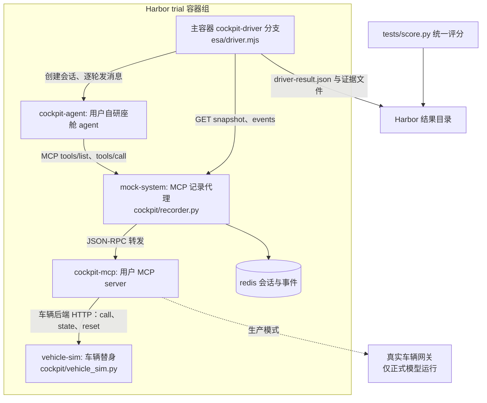

# 座舱 Agent 评测改造方案

状态：方案稿，待评审。日期：2026-11-04。范围：QIU-77777/ESA-bench 全仓库。

## 1. 目标与前提

### 1.1 评测对象与工具来源

- 评测对象：用户自研座舱 agent。该 agent 是独立程序，自带对话循环，自行调用工具并产出回复。
- 工具来源：用户设计的本地 MCP server。该 server 提供直接操作车辆的工具，生产环境后端是真实车辆。
- 交付目标：ESA-bench 把该 agent 作为被测对象，跑通 Harbor 调度、证据采集、统一评分、原生 Oracle 验收全链路；现有七题、esa harness 与评分实现保持不动。

### 1.2 设计前提

1. 证据格式与评分实现不变。座舱试验产出的证据文件结构与现有 ESAAgent 完全一致，`esa/score.py`、`esa/state_score.py`、Harbor view 与 Console 的结果页直接复用。
2. 车辆后端可配置。用户的 MCP server 把车辆后端地址做成环境变量。评测时该变量指向车辆替身，生产时指向真实车辆网关。工具集合与工具行为在同一进程内保持一致。
3. 验收只用替身。参考验证、原生 Oracle 验收、错误答案测试全部在车辆替身上执行。真实车辆只用于正式模型运行，且单独串行执行。
4. 座舱能力以新增组件提供。新增 `cockpit/` 目录、`esa/cockpit_agent.py`、驱动分支、配置与任务模板；不改动 `environment/`、`runtime/`、`esa/score.py`、`esa/state_score.py` 的现有行为。

## 2. 现状摘要

以下结论来自对仓库源码的通读，是方案的事实基础。

### 2.1 批量评测链路

```text
Harbor trial
  ├─ ESAAgent（esa/esa_agent.py，import_path esa.esa_agent:ESAAgent）
  │    ├─ setup：上传 esa/driver.mjs 与 esa/agent.json 到容器 /tmp/esa
  │    ├─ run：下载任务镜像内的 /opt/esa/initial_state.json
  │    │        → 宿主侧参考预检（esa/reference.py 的 validate_task，
  │    │          经容器内 HTTP 桥接访问 mock-system）
  │    │        → 写 /tmp/esa/driver-config.json
  │    │        → 执行 node driver.mjs --config ...
  │    │        → 读回 driver-result.json，生成 ATIF 轨迹与判分证据
  └─ verifier：任务 tests/score.py（esa/score.py 的逐字节副本）
            读 /logs/agent 证据与 /tests/rubric.json，写 /logs/verifier/reward.json
```

任务容器由 `environment/docker-compose.yaml` 组成，三个服务加主容器：

| 服务 | 镜像 | 职责 |
|---|---|---|
| mock-system | esa-local-environment:2.0.0 | Python 工具服务。61 项工具，只读 SQLite 固定资料，Redis 会话状态。提供 `/eval/api/v1/sessions`、`/eval/mcp/{sid}`（MCP JSON-RPC）、`/api/v1/rl/sessions/{sid}/snapshot`、`/events`、`/round`、`/reset` |
| agent-api | esa-react-runtime:1.0.0 | Go ReAct runtime。`POST /v1/run`：按 instructions 与 tools 调用模型 Responses API，串行执行 tools/call，支持多轮 user_messages 与 SSE |
| redis | redis:7-alpine | 会话记录持久化 |
| 主容器 | node:22-alpine | 运行 driver.mjs，持有 /opt/esa/initial_state.json |

模型循环在 Go runtime 内：每轮先 `POST /eval/api/v1/sessions/{sid}/round`，再 `tools/list` 转换模型工具，随后模型迭代与串行 `tools/call`，直到产出回复。驱动脚本不执行 ReAct 循环。

### 2.2 任务目录与运行入口

标准任务目录（以 `tasks/esa-navi-execute` 为样例）：`instruction.md`、`task.toml`、`environment/{Dockerfile,docker-compose.yaml,esa/initial_state.json}`、`solution/{solve.sh,runner.py,reference.py,reference_runtime.py}`、`tests/{rubric.json,negative_tests.py,score.py,state_score.py,test.sh}`。

- Harbor 原生 Oracle 执行 `solution/solve.sh` → `runner.py`（`esa/oracle.py` 副本）→ `reference_runtime.py`（`esa/reference.py` 副本）加载 `reference.py` 的 `solve(ctx)`。`ctx.call` 经 HTTP 访问真实 MCP，不读取 rubric 与错误测试。
- verifier 在评分阶段接收 `tests/`。普通模型运行不接收 `solution/` 与评分答案。
- 共享执行器、Oracle 入口与评分副本由 `scripts/sync-task-scorers.py` 同步，`--check` 强制逐字节一致。
- 正式运行：`scripts/render-job.py` 合并 bench、harness、model、job 四层配置生成 Harbor job；`scripts/run.sh` 加载 `.env` 后调用 `harbor run`。

### 2.3 证据契约

驱动结果 `driver-result.json` 与 `esa/esa_agent.py` 的 `_write_artifacts` 产出以下文件，是评分的唯一输入：

| 文件 | 内容 | 座舱模式的来源 |
|---|---|---|
| tool-calls.json | calls、events、dialogue、turn_status、program_failure | recorder 事件 + 驱动对话 |
| reply.txt | 最终回复 | agent 返回 |
| dialogue.json | 逐轮 user/assistant 对话 | 驱动记录 |
| snapshot-initial.json、snapshot-final.json | 会话快照，含 state 与 manifest 指纹 | recorder 取自车辆替身 |
| state-events.json | 工具事件，含参数、结果、序号、前后版本、JSON 差异 | recorder |
| environment-manifest.json | runtime 与环境版本、指纹 | recorder |
| trajectory.json | ATIF 轨迹，esa 模式每次 ReAct 迭代一个 step | 座舱模式每轮一条 agent step，由驱动输出组装 |

`esa/score.py` 的 `evaluate(rubric, evidence, judge_runner)` 只消费上述证据：`expected_state`、`forbidden_changes`、`process_constraints` 基于快照与事件；`tool_checks`、`tool_forbidden` 基于 calls 与事件；`reply_checks` 基于对话与回复。程序异常、证据缺失、必需 judge 缺席均使评分无效且总分为零。

### 2.4 参考验证与原生 Oracle 验收

`esa/reference.py` 的 `validate_task` 在宿主侧执行参考程序、合法替代解与错误答案测试，全部经真实 HTTP/MCP，使用独立会话，并检查各变体环境指纹一致。任务加入 `configs/bench/esa.yaml` 与 `configs/jobs/esa-oracle-acceptance.yaml` 后，必须通过实际 Docker 环境验收。`scripts/test-oracle-failure.py` 检查达标后异常仍然被拒绝。无模型凭据的集成验证由 `esa/fake_responses.py` 提供确定性模型接口。

### 2.5 交互链路

`esa/cli.py chat` 与 Console 的 Chat 页（`console/app/services/chat_service.py`）是同一模式：启动 `docker-compose.dev.yaml`（mock-system、agent-api、redis），创建会话，逐轮把用户消息发给 Go runtime，落盘与批量评测一致的证据。Console 的 `capability_registry` 从 `configs/harnesses/*.yaml`、`esa/agent.json`、`environment/catalog.json`、`configs/tools.json`、`environment/manifest.json` 读取 harness 与环境卡片。

## 3. 差距分析

| 需求 | 现状 | 差距 |
|---|---|---|
| 被测对象是独立座舱 agent | 被测对象是模型，由 Go runtime 执行 ReAct 循环 | 需要 agent 接入契约与驱动分支，替代 runtime 的模型循环 |
| 工具来自用户 MCP server | 工具由 `environment/` 的 61 个 handler 提供，SQLite 加 Redis | 需要把工具调用转发到用户 MCP server，并保持事件、快照、幂等、故障语义 |
| 工具直接操作车辆 | 环境服务只写会话状态，不控制真实车辆 | 需要车辆替身与真车网关两种后端，及状态读取接口 |
| 证据链不变 | 证据由 environment 服务与 driver 产出 | recorder 必须逐条实现与 environment 服务相同的 HTTP 与 MCP 路由 |
| 任务可评分 | rubric 基于 ESA 状态结构 | 座舱任务的 expected_state 点路径基于替身状态结构，评分实现不变 |
| Oracle 验收 | 参考程序经 ctx.call 打 MCP | recorder 的 MCP 端点即参考程序的工具入口，验收流程不变 |
| 故障注入 | environment 服务支持 reject、missing_field、response_lost | 故障注入前移到 recorder 转发层 |
| CLI 与 Console 对话 | 驱动 Go runtime | 需要座舱开发服务组合与座舱对话驱动 |

## 4. 改造方案

### 4.1 总体数据流



要点：驱动逐轮把用户消息发给座舱 agent；agent 经 recorder 调用用户 MCP server；MCP server 的车辆后端在评测时指向替身；recorder 录制全部调用与状态变化；驱动拉取快照与事件，组装与现有格式一致的证据。

### 4.2 新增目录与组件

```text
cockpit/
  recorder.py                # MCP 记录代理：ESA 环境协议加 MCP 转发
  recorder_test.py           # recorder 单元与集成测试
  vehicle_sim.py             # 车辆替身：状态、reset、call、state 查询
  vehicle_sim_test.py        # 替身测试
  fake_agent.py              # 确定性假座舱 agent，用于无凭据全链路验收
  Dockerfile.recorder        # recorder 镜像
  Dockerfile.vehicle-sim     # 替身镜像
  README.md                  # 组件契约说明
esa/
  cockpit_agent.py           # Harbor Agent：CockpitAgent，继承 ESAAgent
configs/
  harnesses/esa-cockpit.yaml
  bench/esa-cockpit.yaml
  jobs/esa-cockpit-oracle-acceptance.yaml
tasks/
  esa-cockpit-navi/          # 示例：导航
  esa-cockpit-climate/       # 示例：空调澄清
docs/
  esa-cockpit-agent-eval-plan.md   # 本方案
  esa-cockpit-integration.md       # 接入契约：agent、MCP server、车辆网关
docker-compose.cockpit.yaml        # 开发服务组合：recorder、agent、mcp、替身、redis
```

`esa/driver.mjs` 增加座舱分支，不拆文件。`esa/esa_agent.py` 不改；`esa/cockpit_agent.py` 以继承方式复用其产物逻辑。

### 4.3 MCP 记录代理（recorder）接口契约

recorder 在座舱模式中替代 environment 服务：对外实现与 `environment/server.py` 完全一致的路由，对内把工具执行转发给用户 MCP server，把状态读写转发给车辆替身。路由表：

| 方法与路径 | 语义 | 与 environment 服务的差异 |
|---|---|---|
| `GET /health` | 健康状态，返回 dataset_version 与启用工具数 | 启用工具数取自用户 MCP server 的 tools/list |
| `POST /eval/api/v1/sessions` | 创建会话，接收 type、context、initial_state、data_overlays、tool_profile、faults、seed、dataset_version，新增接收 agent、vehicle 两个字段 | 创建时把 vehicle.initial_state 下发给替身；拒绝携带 expected、tool_overrides 等评分字段，与现服务一致 |
| `POST /eval/mcp/{sid}` | MCP JSON-RPC：initialize、tools/list、tools/call | tools/list 透传用户 MCP server 结果并按会话缓存；tools/call 先匹配 faults，再转发，结果写入 Redis 事件 |
| `GET /api/v1/rl/sessions/{sid}/snapshot` | 快照：context、state、initial_state、版本、manifest | state 取自替身 `GET /state`；manifest 的 source_sha256 取用户 MCP server tools/list 序列化哈希 |
| `GET /api/v1/rl/sessions/{sid}/events` | 事件列表，支持 after 与 call_id | 事件由 recorder 自己记录，字段与现服务一致：sequence、call_id、tool、完整参数、结果、status、前后 state_version、JSON Pointer changes |
| `POST /eval/api/v1/sessions/{sid}/round` | 开始新轮次 | 透传给替身重置轮次焦点 |
| `POST /eval/api/v1/sessions/{sid}/reset` | 恢复初态 | 重置替身状态，清空幂等缓存与故障计数 |
| `DELETE /eval/api/v1/sessions/{sid}` | 删除会话 | 同时删除替身会话 |
| `GET /eval/api/v1/manifest` | 能力清单 | 由 tools/list 与调用统计生成，记录工具名、参数 schema、调用次数 |

语义逐条对照 `environment/README.md` 与 `docs/esa-local-eval-spec.md`：

1. 原子事件。每次 tools/call 在一条 Redis 记录里提交 state_version、事件与幂等缓存，冲突重试有上限。
2. 幂等。相同 call_id 与相同参数返回已提交结果，不产生重复副作用；相同 call_id 不同参数保存拒绝事件。
3. 故障注入。faults 支持 reject（执行前拒绝并返回错误）、missing_field（结果删除指定点路径字段）、response_lost（提交成功后断开连接），匹配工具、参数与次数，语义与现服务一致。故障在 recorder 层执行，对待测 agent 与用户 MCP server 透明。
4. 状态版本与差异。替身每次调用返回新的 state_version 与前后状态；recorder 计算 JSON Pointer 差异写入事件。状态没有变化时不增加版本。
5. 指纹。snapshot 的 manifest 包含 implementation_sha256（recorder 实现哈希）、source_sha256（用户 MCP server 工具 schema 哈希）、seed_sha256、dataset_version。参考验证的变体一致性检查直接复用。

recorder 配置经环境变量注入：`COCKPIT_MCP_URL`（用户 MCP server 地址）、`VEHICLE_SIM_URL`（替身地址）、`REDIS_URL`、`COCKPIT_STATE_TOOL`（可选，真车模式下用哪个工具读全量状态，默认 get_vehicle_state）。

### 4.4 车辆替身与真车网关契约

车辆替身实现与真实车辆网关相同的 HTTP 协议。用户 MCP server 的车辆后端指向该地址即可在评测中运行。

| 方法与路径 | 语义 |
|---|---|
| `POST /reset` | 用给定初态重置车辆状态，body 为任务的 vehicle.initial_state |
| `POST /call` | 执行一个车辆操作，body 含 tool 与 arguments；返回 before、after、state_version、result |
| `GET /state` | 返回全量车辆状态 JSON |
| `GET /health` | 健康状态 |

约束：

1. 替身状态按会话隔离。recorder 创建会话时携带 session_id，替身以 `POST /sessions/{sid}/reset` 初始化；上面的 `/reset`、`/call`、`/state` 均带会话前缀。并发 trial 各自独立。
2. 确定性。替身不访问网络，不读时钟，全部行为由初态与调用序列决定。同初态同调用序列必须得到同终态。
3. 真车网关由用户方提供，实现同一组 HTTP 方法。正式模型运行经任务配置把 MCP server 后端指向网关；参考验证与 Oracle 验收不经网关。真车模式下没有替身，recorder 的快照改经 `COCKPIT_STATE_TOOL` 指定的工具（默认 get_vehicle_state）从用户 MCP server 读取全量状态。
4. 状态结构自由。vehicle.initial_state 是任意 JSON 对象，rubric 的 expected_state 点路径直接指向该结构，评分实现不变。

### 4.5 座舱 agent 接入契约

主路径：agent 以 HTTP 服务接入。端点契约如下：

| 方法与路径 | 请求 | 响应 |
|---|---|---|
| `GET /v1/health` | 无 | 200，`{"status":"ok"}` |
| `POST /v1/turn` | `{"session_id": "...", "message": "用户消息", "history": [{"role":"user"\|"assistant","content":"..."}]}` | `{"reply": "助手回复", "status": "completed", "usage": {"input_tokens": 0, "output_tokens": 0}}`，usage 可选 |

约束：

1. agent 从环境变量获得 MCP 地址：`ESA_MOCK_URL` 与 session_id 拼出 `/eval/mcp/{session_id}`。agent 每轮先 `tools/list` 再调用。
2. history 由驱动每轮完整传入，agent 可以无状态。多轮共用同一 session_id 与同一车辆会话。
3. agent 不得读取任务目录、rubric、solution 与 tests。容器内本就不放置这些文件，任务镜像只复制初态，与现有一致。
4. 模型凭据由 agent 自行管理，经 compose 环境变量注入；密钥不落盘进证据。
5. agent 镜像来源两种，任选其一：作为 harness 镜像预构建并只读挂载（参照 `harness/pi` 的 manifest 与 Dockerfile 模式）；或作为任务 compose 服务，由任务 Dockerfile 安装。示例任务采用 compose 服务方式。
6. 状态约定：`status` 为 completed、failed、timeout 之一。failed 与 timeout 由驱动记为执行错误，评分无效，与现驱动对 runtime 失败的处理一致。

退化路径：agent 无法提供 HTTP 服务时，可以命令行进程接入，驱动以子进程运行，约定 stdin 收 JSON 行（message 与 history），stdout 回 JSON 行（reply 与 status）。该路径只用于本地试用，批量评测以 HTTP 路径为准。

### 4.6 驱动与 Harbor agent

`esa/driver.mjs` 增加座舱分支，由配置字段 `agentProtocol` 选择，取值 react（现有行为）与 turn（座舱）。座舱分支流程：

```text
1. POST recorder /eval/api/v1/sessions，body 与现分支一致，附带 agent 与 vehicle 字段
2. GET snapshot 得初态
3. 逐轮循环（固定 user_messages 或 user_script 分支，逻辑与现分支相同）：
   a. POST agent /v1/turn，body 带 session_id、message、history
   b. GET recorder /events?after=上一轮序号，取本轮调用
   c. 组装一条 iteration：message 为回复，toolCalls 为本轮调用，status 为 completed
   d. dialogue 追加 user 与 assistant 两条；user_script 分支匹配逻辑原样复用
4. GET snapshot 得终态，GET events 得全量事件
5. 组装 driver-result.json，字段与 Go runtime 的 RunResult 同构：
   iterations、toolCalls、turns、reply、status、dialogue、user_script_complete
```

`esa/cockpit_agent.py` 定义 `CockpitAgent(ESAAgent)`：`name()` 返回 `esa-cockpit`；setup 跳过 agent.json 上传；run 的配置增加 `agentProtocol: "turn"`；其余产物逻辑（ATIF 组装、证据文件、参考预检）全部继承。座舱试验的 ATIF 轨迹每轮一条 agent step，step 的 tool_calls 取自本轮事件，usage 缺失时按现有规则省略，不补零值。

`configs/harnesses/esa-cockpit.yaml` 内容：

```yaml
id: esa-cockpit
name: ESA Cockpit
protocol: openai
import_path: esa.cockpit_agent:CockpitAgent
kwargs: {}
param_docs:
  agent_protocol: 座舱 agent 驱动协议，固定为 turn
```

`scripts/render-job.py` 与 `scripts/run.sh` 不变：仍按 provider/model-id 选择模型配置并校验连接变量，模型身份记入 Harbor 结果用于报告；模型凭据经 compose 注入 agent 服务，由 agent 自行调用模型。harness 无 manifest 字段，不走镜像挂载，与现有 esa harness 一致。

`esa/reference.py` 的 `SESSION_FIELDS` 增加 `agent` 与 `vehicle` 两个字段，使参考程序与会话创建把车辆初态传给 recorder。该文件经 `scripts/sync-task-scorers.py` 同步到各任务副本，改动后必须执行同步与 `--check`。

### 4.7 任务定义扩展

`environment/esa/initial_state.json` 新增字段：

```json
{
  "case_id": "esa-cockpit-navi",
  "dataset_version": "esa-cockpit-v1",
  "seed": 0,
  "user_messages": ["导航去公司。"],
  "agent": {"endpoint": "http://cockpit-agent:8090", "protocol": "http-turn"},
  "vehicle": {"target": "simulator", "initial_state": {"gear": "D", "navigation": {"active": false}}},
  "tool_profile": ["get_favorite_poi", "start_navi"],
  "metadata": {"domain": "navi", "acceptance": true, "title": "查询公司地址并启动导航"}
}
```

`environment/docker-compose.yaml` 服务组成：

```yaml
services:
  mock-system:                 # recorder，服务名保持 mock-system
    image: ${MOCK_SYSTEM_IMAGE:-esa-cockpit-recorder:1.0.0}
    environment:
      REDIS_URL: redis://redis:6379/0
      COCKPIT_MCP_URL: http://cockpit-mcp:8091
      VEHICLE_SIM_URL: http://vehicle-sim:8092
  cockpit-agent:               # 用户自研座舱 agent
    image: ${COCKPIT_AGENT_IMAGE:-esa-cockpit-agent:1.0.0}
    environment:
      ESA_MOCK_URL: http://mock-system:8003
      AGENT_MODEL_BASE_URL: ${COCKPIT_AGENT_MODEL_BASE_URL:-}
      AGENT_MODEL_API_KEY: ${COCKPIT_AGENT_MODEL_API_KEY:-}
  cockpit-mcp:                 # 用户 MCP server
    image: ${COCKPIT_MCP_IMAGE:-esa-cockpit-mcp:1.0.0}
    environment:
      VEHICLE_BACKEND_URL: http://vehicle-sim:8092
  vehicle-sim:                 # 车辆替身
    image: ${VEHICLE_SIM_IMAGE:-esa-cockpit-vehicle-sim:1.0.0}
  redis:
    image: redis:7-alpine
```

`task.toml` 的 `[environment.env]` 增加 `ESA_AGENT_API_URL=http://cockpit-agent:8090`，驱动经该地址找到座舱 agent；`ESA_MOCK_URL` 保持 `http://mock-system:8003`，指向 recorder。`[environment.healthcheck]` 检查 recorder 与替身两个健康地址；座舱 agent 不参与 Oracle 执行，不设强制健康检查。`[environment] network_mode` 保持 public，模型 API 与 localhost 访问经 Harbor 任务网络配置管理。

`tests/rubric.json` 结构不变：`expected_state` 的点路径指向替身状态，例如 `navigation.active`、`navigation.destination.id`；`forbidden_changes`、`tool_checks`、`process_constraints`、`reply_checks`、`user_script`、`faults` 全部沿用现有语义。

### 4.8 参考验证与原生 Oracle

1. 参考程序 `solve(ctx)` 不变：`ctx.call` 打到 recorder 的 `/eval/mcp/{sid}`，由 recorder 转发到用户 MCP server 与替身。参考预检 `validate_task` 的传输地址 `ESA_MOCK_URL` 指向 recorder，流程与检查项不变。
2. 新增 `configs/jobs/esa-cockpit-oracle-acceptance.yaml`，agent 为 Harbor 原生 oracle，模型地址与密钥用不可用值占位。Oracle 不调用 agent 与模型，只执行参考程序。
3. 新增 `esa/fake_agent.py` 的对应实现 `cockpit/fake_agent.py`：确定性座舱 agent，按消息内容调用固定工具序列并返回固定回复，用于无模型凭据的座舱全链路验收，角色与 `esa/fake_responses.py` 相同。
4. 新增 `configs/bench/esa-cockpit.yaml` 收录座舱任务；座舱 bench 与 esa bench 分开，结果与分数不做直接比较，理由与仓库现有约定一致：环境身份不同。

### 4.9 网络、并发与真车安全

1. 网络。座舱任务容器访问模型 API 与 compose 内服务；Harbor 侧按任务网络配置管理。真车网关地址经 `VEHICLE_BACKEND_URL` 注入，指向宿主或车域网关；容器到网关的连通性由用户环境保证。
2. 并发。替身与 recorder 按会话隔离，支持并发 trial。真实车辆是共享资源，正式模型运行接真车时 `n_concurrent_trials` 置 1，并在任务配置中声明串行；不同任务对同一车辆的写入互斥由车辆网关或调度保证。
3. 安全。真车模式的参考验证与 Oracle 验收一律使用替身；任务超时即终止容器，未完成调用不重试；高风险工具（启动、解锁、制动相关）是否开放由任务的 tool_profile 决定，评分侧的 forbidden 规则约束模型行为。

### 4.10 CLI 与 Console 适配

1. 新增 `docker-compose.cockpit.yaml` 开发服务组合：recorder、cockpit-agent、cockpit-mcp、vehicle-sim、redis，端口绑定 127.0.0.1。
2. `esa/cli.py chat` 增加 `--cockpit`：使用座舱开发服务组合，逐轮调用 agent 的 `/v1/turn`，从 recorder 拉取事件，落盘与批量评测一致的证据。`--local` 模式在宿主直接以进程启动 recorder、替身与 agent。
3. `console/app/services/chat_service.py` 增加座舱服务组合分支：`STACK_FILE` 切换到 `docker-compose.cockpit.yaml`，就绪检查改查 recorder 与 agent 的健康地址，逐轮驱动逻辑与 CLI 同一实现。
4. `console/app/services/capability_registry.py` 的环境列表增加 `esa-cockpit`，卡片内容读取 recorder 与替身的运行期信息；harness 列表经 `configs/harnesses/esa-cockpit.yaml` 自动出现，参数说明写入 `param_docs`。

### 4.11 构建脚本

`scripts/build-esa-local.sh` 增加三个镜像构建：recorder、vehicle-sim、cockpit-agent。前两个由本仓库构建；cockpit-agent 镜像由用户的 agent 源码构建，构建入口放在用户提供的 Dockerfile，脚本以 `COCKPIT_AGENT_DOCKERFILE` 环境变量指定，未提供时跳过并提示。`scripts/diagnose.sh` 的公共镜像清单与期望服务列表需要扩展：镜像清单增加座舱三个镜像，期望服务按任务类型区分（esa 任务为 main、agent-api、mock-system、redis；座舱任务为 main、mock-system、cockpit-agent、cockpit-mcp、vehicle-sim、redis）。`scripts/cleanup.sh` 按 `hb__` 前缀清理容器与任务镜像，与 harness 无关，无需改动。

## 5. 示例任务

两个示例任务覆盖单轮执行与澄清两类交互，文件结构沿用标准任务目录。

`tasks/esa-cockpit-navi`：单轮导航。user_messages 一条；vehicle.initial_state 给出挡位与关闭的导航；tool_profile 两项；rubric 检查 navigation.active 与 destination.id、start_navi 调用一次、回复含距离与时间。

`tasks/esa-cockpit-climate`：空调澄清。user_messages 一条；user_script 一条分支，匹配温度询问后给出目标温度；rubric 检查确认前未调用控制工具（tool_forbidden 加 before_turn）、确认后 ac_temperature 等于目标值、对应轮次回复包含温度。该任务采用与 `tasks/esa-veh-clarify` 相同的评分结构，把状态与工具换成座舱链路。

两个任务的 solution 与 tests 按现有约定编写：参考程序只用用户消息与工具返回；错误答案至少两个；`tests/score.py` 与 `tests/state_score.py` 由同步脚本维护副本。

## 6. 验收方案

按阶段执行，每阶段有明确检查命令。全部命令在仓库根目录执行。

阶段一，替身：

```bash
.venv/bin/python -m unittest cockpit.vehicle_sim_test -v
```

检查项：状态重置、call 前后差异、同序列确定性、会话隔离。

阶段二，recorder：

```bash
.venv/bin/python -m unittest cockpit.recorder_test -v
ESA_TEST_REDIS_URL=redis://127.0.0.1:6379/0 .venv/bin/python -m unittest cockpit.recorder_test -v
```

检查项：路由与 environment 服务一致、事件字段完整、幂等、三类故障、快照指纹、round 与 reset。Redis 集成测试覆盖事务与隔离。

阶段三，驱动与全链路（无模型凭据）：

```bash
.venv/bin/python scripts/sync-task-scorers.py
.venv/bin/python scripts/sync-task-scorers.py --check
.venv/bin/python scripts/validate_task.py --all --local-http --json
.venv/bin/python scripts/test-reference-docker.py
PYTHONPATH="$PWD" .venv/bin/harbor run -c configs/jobs/esa-cockpit-oracle-acceptance.yaml --job-name UNIQUE -y
.venv/bin/python scripts/test-oracle-failure.py
```

检查项：参考、替代解、错误答案在 recorder 加替身上全部符合现有判定；Oracle 实际 Docker 验收通过；异常后达标被拒绝。

阶段四，座舱 agent 接入：

```bash
bash scripts/build-esa-local.sh            # 构建 recorder、替身与 agent 镜像
.venv/bin/python -m esa.cli chat --cockpit # 人工对话冒烟
```

检查项：agent 经 recorder 调用 MCP 成功；证据文件与批量评测一致；Console Chat 页可用座舱服务组合对话。

阶段五，正式模型运行：

```bash
.venv/bin/python scripts/render-job.py --bench esa-cockpit --harness esa-cockpit --model <provider/model-id> --output /tmp/esa-cockpit-job.yaml
PYTHONPATH="$PWD" .venv/bin/harbor run -c /tmp/esa-cockpit-job.yaml --job-name UNIQUE -y
```

检查项：试验完成、证据完整、评分有效；接真车时串行执行并保留车辆侧日志。

回归要求：现有测试全部保持通过，命令与 README 的开发验证一节一致；座舱改动不触发 `environment/`、`runtime/`、`esa/score.py`、`esa/state_score.py` 的行为变化。

## 7. 实施顺序

1. 契约与替身。写 `docs/esa-cockpit-integration.md`，实现 `cockpit/vehicle_sim.py` 与测试。产出：替身协议冻结。
2. 记录代理。实现 `cockpit/recorder.py` 与测试，对照 `environment/server.py` 路由逐条验收。产出：recorder 可独立替代 environment 服务。
3. 驱动与 Harbor agent。实现 driver.mjs 座舱分支、`esa/cockpit_agent.py`、`cockpit/fake_agent.py`，跑通阶段三命令。产出：无凭据全链路验收通过。
4. 任务与配置。实现任务模板与两个示例任务，加入 bench 与 Oracle 验收配置，完成原生 Oracle 验收与失败回归。产出：座舱 bench 可复现。
5. 用户资产接入。构建用户 agent 与 MCP server 镜像，实现 CLI 与 Console 座舱分支，真车网关联调。产出：正式模型可评分运行。

每个阶段可独立验证，前一阶段不通过不进入下一阶段。

## 8. 风险与限制

1. 用户 MCP server 必须把车辆后端做成可配置。后端写死真实车辆时，评测只能改用替身重新实现全部工具，存在行为偏差；该偏差会使参考验证结论只覆盖替身，不覆盖真车。
2. 模型用量指标依赖 agent 透传。agent 不回传 usage 时，ATIF 轨迹省略用量字段，成本对比维度在座舱 bench 中不可用，其余维度不受影响。
3. 工具定义的静态校验不适用于座舱模式。`environment/catalog.json` 与 `configs/tools.json` 的一致性检查只服务 esa harness；座舱工具集合以运行时 tools/list 为准，manifest 的 source_sha256 记录该次 schema 指纹。
4. 真车不可重复。真车运行的结果受车辆实际状态影响，只用于正式模型运行，不做参考验证；需要可重复结论时一律使用替身。
5. 故障注入覆盖 recorder 层。reject、missing_field、response_lost 三类故障在 recorder 执行，不要求用户 MCP server 改造；超出三类的故障需要扩展 recorder 与任务 faults 定义。
6. 座舱 bench 与 esa bench 的分数不做直接比较，原因与仓库现有约定一致：环境身份、工具集合与状态结构不同。
