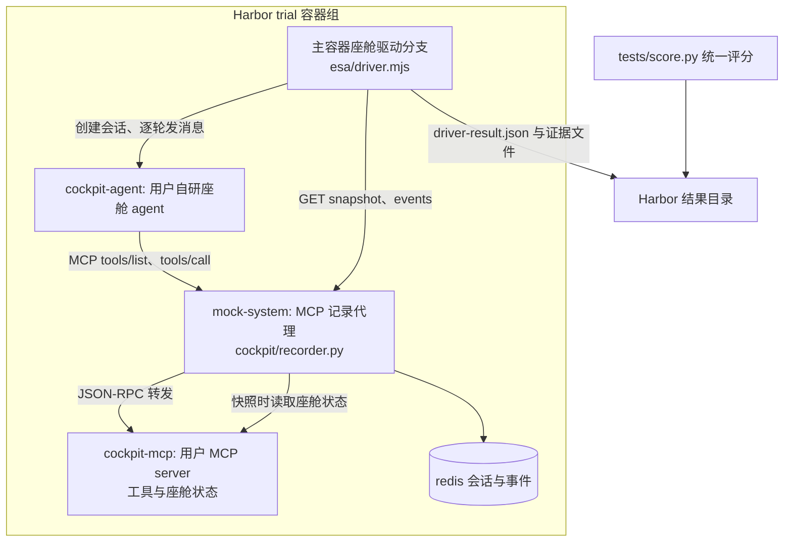

# 座舱 Agent 评测改造方案

状态：方案稿，待评审。日期：2026-11-04。范围：QIU-77777/ESA-bench 全仓库。修订记录见文末第 9 节。

## 1. 目标与前提

### 1.1 评测对象与工具来源

- 评测对象：用户自研座舱 agent。该 agent 是独立程序，自带对话循环，自行调用工具并产出回复。
- 工具来源：用户设计的本地 MCP server。该 server 给 agent 提供可调用的工具并返回结果，座舱状态由该 server 维护。评测不连接真实车辆，不使用外部物理设备，全部过程在容器内完成。
- 交付目标：ESA-bench 把该 agent 作为被测对象，跑通 Harbor 调度、证据采集、统一评分、原生 Oracle 验收全链路；现有七题、esa harness 与评分实现保持不动。

### 1.2 设计前提

1. 证据格式与评分实现不变。座舱试验产出的证据文件结构与现有 ESAAgent 完全一致，`esa/score.py`、`esa/state_score.py`、Harbor view 与 Console 的结果页直接复用。
2. 用户的 MCP server 可在任务容器内以 HTTP 提供 MCP 服务，按会话隔离座舱状态，并上报数据版本与实现版本。具体契约见 4.4。
3. 评测完全在容器内进行。每个 trial 独立 compose 项目、独立会话、独立状态，结果由初态与调用序列决定，不依赖外部设备、真实时钟与随机数。
4. 座舱能力以新增组件提供。新增 `cockpit/` 目录、`esa/cockpit_agent.py`、驱动分支、配置与任务模板；不改动 `environment/`、`runtime/`、`esa/score.py`、`esa/state_score.py` 的现有行为。

## 2. 现状摘要

以下结论来自对仓库源码的通读，是方案的事实基础。

### 2.1 批量评测链路

```text
Harbor trial
  ├─ ESAAgent（esa/esa_agent.py，import_path esa.esa_agent:ESAAgent）
  │    ├─ setup：上传 esa/driver.mjs 与 esa/agent.json 到容器 /tmp/esa
  │    ├─ run：下载任务镜像内的 /opt/esa/initial_state.json
  │    │        → 宿主侧参考预检（esa/reference.py 的 validate_task，
  │    │          经容器内 HTTP 桥接访问 mock-system）
  │    │        → 写 /tmp/esa/driver-config.json
  │    │        → 执行 node driver.mjs --config ...
  │    │        → 读回 driver-result.json，生成 ATIF 轨迹与判分证据
  └─ verifier：任务 tests/score.py（esa/score.py 的逐字节副本）
            读 /logs/agent 证据与 /tests/rubric.json，写 /logs/verifier/reward.json
```

任务容器由 `environment/docker-compose.yaml` 组成，三个服务加主容器：

| 服务 | 镜像 | 职责 |
|---|---|---|
| mock-system | esa-local-environment:2.0.0 | Python 工具服务。61 项工具，只读 SQLite 固定资料，Redis 会话状态。提供 `/eval/api/v1/sessions`、`/eval/mcp/{sid}`（MCP JSON-RPC）、`/api/v1/rl/sessions/{sid}/snapshot`、`/events`、`/round`、`/reset` |
| agent-api | esa-react-runtime:1.0.0 | Go ReAct runtime。`POST /v1/run`：按 instructions 与 tools 调用模型 Responses API，串行执行 tools/call，支持多轮 user_messages 与 SSE |
| redis | redis:7-alpine | 会话记录持久化 |
| 主容器 | node:22-alpine | 运行 driver.mjs，持有 /opt/esa/initial_state.json |

模型循环在 Go runtime 内：每轮先 `POST /eval/api/v1/sessions/{sid}/round`，再 `tools/list` 转换模型工具，随后模型迭代与串行 `tools/call`，直到产出回复。驱动脚本不执行 ReAct 循环。

### 2.2 任务目录与运行入口

标准任务目录（以 `tasks/esa-navi-execute` 为样例）：`instruction.md`、`task.toml`、`environment/{Dockerfile,docker-compose.yaml,esa/initial_state.json}`、`solution/{solve.sh,runner.py,reference.py,reference_runtime.py}`、`tests/{rubric.json,negative_tests.py,score.py,state_score.py,test.sh}`。

- Harbor 原生 Oracle 执行 `solution/solve.sh` → `runner.py`（`esa/oracle.py` 副本）→ `reference_runtime.py`（`esa/reference.py` 副本）加载 `reference.py` 的 `solve(ctx)`。`ctx.call` 经 HTTP 访问真实 MCP，不读取 rubric 与错误测试。
- verifier 在评分阶段接收 `tests/`。普通模型运行不接收 `solution/` 与评分答案。
- 共享执行器、Oracle 入口与评分副本由 `scripts/sync-task-scorers.py` 同步，`--check` 强制逐字节一致。
- 正式运行：`scripts/render-job.py` 合并 bench、harness、model、job 四层配置生成 Harbor job；`scripts/run.sh` 加载 `.env` 后调用 `harbor run`。

### 2.3 证据契约

驱动结果 `driver-result.json` 与 `esa/esa_agent.py` 的 `_write_artifacts` 产出以下文件，是评分的唯一输入：

| 文件 | 内容 | 座舱模式的来源 |
|---|---|---|
| tool-calls.json | calls、events、dialogue、turn_status、program_failure | recorder 事件 + 驱动对话 |
| reply.txt | 最终回复 | agent 返回 |
| dialogue.json | 逐轮 user/assistant 对话 | 驱动记录 |
| snapshot-initial.json、snapshot-final.json | 会话快照，含 state 与 manifest 指纹 | recorder 取自用户 MCP server 的状态读取能力 |
| state-events.json | 工具事件，含参数、结果、序号、前后版本、逐条 JSON 差异 | recorder |
| environment-manifest.json | runtime 与环境版本、指纹 | recorder |
| trajectory.json | ATIF 轨迹，esa 模式每次 ReAct 迭代一个 step | 座舱模式每轮一条 agent step，由驱动输出组装 |

`esa/score.py` 的 `evaluate(rubric, evidence, judge_runner)` 只消费上述证据：`expected_state`、`forbidden_changes`、`process_constraints` 基于快照与事件；`tool_checks`、`tool_forbidden` 基于 calls 与事件；`reply_checks` 基于对话与回复。程序异常、证据缺失、必需 judge 缺席均使评分无效且总分为零。

其中 `forbidden_changes` 的判定读每条事件的 `changes` 字段（`state_score.py:119`），修改后恢复同样判违规；`process_constraints` 的 ordered_tools、max_calls、no_failed_calls 也逐条读事件。座舱模式的 recorder 必须产出逐事件差异，语义才与现服务一致。

### 2.4 参考验证与原生 Oracle 验收

`esa/reference.py` 的 `validate_task` 在宿主侧执行参考程序、合法替代解与错误答案测试，全部经真实 HTTP/MCP，使用独立会话，并检查各变体 manifest 的 implementation_sha256、seed_sha256、source_sha256 三个指纹完全一致（`reference.py:348-352`）。任务加入 `configs/bench/esa.yaml` 与 `configs/jobs/esa-oracle-acceptance.yaml` 后，必须通过实际 Docker 环境验收。`scripts/test-oracle-failure.py` 检查达标后异常仍然被拒绝。无模型凭据的集成验证由 `esa/fake_responses.py` 提供确定性模型接口。

### 2.5 交互链路

`esa/cli.py chat` 与 Console 的 Chat 页（`console/app/services/chat_service.py`）是同一模式：启动 `docker-compose.dev.yaml`（mock-system、agent-api、redis），创建会话，逐轮把用户消息发给 Go runtime，落盘与批量评测一致的证据。Console 的 `capability_registry` 从 `configs/harnesses/*.yaml`、`esa/agent.json`、`environment/catalog.json`、`configs/tools.json`、`environment/manifest.json` 读取 harness 与环境卡片。

## 3. 差距分析

| 需求 | 现状 | 差距 |
|---|---|---|
| 被测对象是独立座舱 agent | 被测对象是模型，由 Go runtime 执行 ReAct 循环 | 需要 agent 接入契约与驱动分支，替代 runtime 的模型循环 |
| 工具来自用户 MCP server | 工具由 `environment/` 的 61 个 handler 提供，SQLite 加 Redis | 需要把工具调用转发到用户 MCP server，并保持事件、幂等、故障语义 |
| 工具在容器内返回结果，无真实车辆 | 环境服务本地计算并写会话状态 | recorder 转发调用到用户 MCP server，无需车辆网关与后端切换 |
| 工具权限由框架执行 | `list_tools` 按会话 tool_profile 过滤，`execute` 对会话外工具判 `PermissionError`（`service.py:149-151,197`） | recorder 必须自己执行同一套权限判定，不能指望通用 MCP server 实现 profile 语义 |
| 证据链不变 | 证据由 environment 服务与 driver 产出 | recorder 必须逐条实现与 environment 服务相同的 HTTP 与 MCP 路由 |
| 逐事件状态差异 | environment 服务在进程内持有状态，调用前后直接 diff（`service.py:220-224`） | 座舱模式状态在用户 MCP server，recorder 需在每次调用前后各读一次状态 |
| 任务可评分 | rubric 基于 ESA 状态结构 | 座舱状态经用户 MCP server 的状态读取能力获取，点路径评分不变 |
| Oracle 验收 | 参考程序经 ctx.call 打 MCP | recorder 的 MCP 端点即参考程序的工具入口，验收流程不变 |
| 故障注入 | environment 服务支持 reject、missing_field、response_lost | 故障注入前移到 recorder 转发层 |
| CLI 与 Console 对话 | 驱动 Go runtime | 座舱对话分支属于交互体验增强，排在评测主线之后 |

## 4. 改造方案

### 4.1 总体数据流



要点：驱动逐轮把用户消息发给座舱 agent；agent 经 recorder 调用用户 MCP server；MCP server 在容器内返回工具结果并维护座舱状态；recorder 录制全部调用、执行工具权限、注入故障、计算逐事件差异；驱动拉取快照与事件，组装与现有格式一致的证据。全程不连接外部设备。

### 4.2 新增目录与组件

```text
cockpit/
  recorder.py                # MCP 记录代理：ESA 环境协议加 MCP 转发
  recorder_test.py           # recorder 单元与集成测试
  fake_agent.py              # 确定性假座舱 agent，默认 agent 镜像来源
  Dockerfile                 # recorder 镜像
  Dockerfile.agent           # 默认座舱 agent 镜像（fake_agent.py）
  README.md                  # 组件契约说明
esa/
  cockpit_agent.py           # Harbor Agent：CockpitAgent，继承 ESAAgent
configs/
  harnesses/esa-cockpit.yaml
  bench/esa-cockpit.yaml
  jobs/esa-cockpit-oracle-acceptance.yaml
tasks/
  esa-cockpit-navi/          # 示例：导航
  esa-cockpit-climate/       # 示例：空调澄清
docs/
  esa-cockpit-agent-eval-plan.md   # 本方案
  esa-cockpit-integration.md       # 接入契约：agent 与 MCP server
docker-compose.cockpit.yaml        # 开发服务组合：recorder、agent、mcp、redis
```

`esa/driver.mjs` 增加座舱分支，不拆文件。`esa/esa_agent.py` 与 `esa/reference.py` 不改；`esa/cockpit_agent.py` 以继承方式复用 `ESAAgent` 的产物逻辑，任务的 `agent` 字段只作任务元数据，不参与会话创建（`reference.py:266` 只取 SESSION_FIELDS 九个键，多余键被忽略）。

recorder 的实现边界：复用 `environment/store.py`（82 行，Redis 事务与记录结构）与 `environment/service.py` 的 `changes()` 差异函数；其余为平行实现。`Environment` 类不能复用：它写死了 ESA 十域状态模板（`service.py:105`）、`validate_state` 硬校验车辆字段（`service.py:120-130`）、catalog 与 handler 覆盖一致检查（`service.py:54-55`）、round 改写 display 焦点（`service.py:162`），这些都与座舱模式无关。排期按平行实现估，不按薄代理估。

### 4.3 MCP 记录代理（recorder）接口契约

recorder 在座舱模式中替代 environment 服务：对外实现与 `environment/server.py` 完全一致的路由，对内把工具执行转发给用户 MCP server，把状态读取也指向该 server。路由表：

| 方法与路径 | 语义 | 与 environment 服务的差异 |
|---|---|---|
| `GET /health` | 健康状态，返回 dataset_version 与启用工具数 | 启用工具数取自用户 MCP server 的 tools/list |
| `POST /eval/api/v1/sessions` | 创建会话，接收 type、context、initial_state、data_overlays、tool_profile、faults、seed、dataset_version | 把 initial_state 等字段转发给用户 MCP server 的会话创建接口（4.4）；tool_profile 对照 server 工具集合校验，未知工具名直接拒绝；拒绝携带 expected、tool_overrides 等评分字段，与现服务一致 |
| `POST /eval/mcp/{sid}` | MCP JSON-RPC：initialize、tools/list、tools/call | tools/list 由 recorder 按会话 tool_profile 过滤后返回（不透传全量）；tools/call 先匹配 faults，会话外工具判 permission_denied，再转发，结果写入 Redis 事件 |
| `GET /api/v1/rl/sessions/{sid}/snapshot` | 快照：context、state、initial_state、版本、manifest | state 取自用户 MCP server 的状态读取能力（4.4）；manifest 的 source_sha256 取 server tools/list 序列化哈希，并增加 server_version 与 server_commit 两个指纹字段 |
| `GET /api/v1/rl/sessions/{sid}/events` | 事件列表，支持 after 与 call_id | 事件由 recorder 自己记录，字段与现服务一致：sequence、call_id、tool、完整参数、结果、status、前后 state_version、逐条 JSON Pointer changes |
| `POST /eval/api/v1/sessions/{sid}/round` | 开始新轮次 | 记录轮次事件，不要求用户 MCP server 有对应接口 |
| `POST /eval/api/v1/sessions/{sid}/reset` | 恢复初态 | 调用户 MCP server 的初态重置能力，清空幂等缓存与故障计数 |
| `DELETE /eval/api/v1/sessions/{sid}` | 删除会话 | 同时删除用户 MCP server 侧会话 |
| `GET /eval/api/v1/manifest` | 能力清单 | 由 tools/list 与调用统计生成，记录工具名、参数 schema、调用次数 |

语义逐条对照 `environment/README.md` 与 `docs/esa-local-eval-spec.md`：

1. 原子事件。每次 tools/call 在一条 Redis 记录里提交 state_version、事件与幂等缓存，冲突重试有上限。
2. 幂等。相同 call_id 与相同参数返回已提交结果，不产生重复副作用；相同 call_id 不同参数保存拒绝事件。
3. 故障注入。faults 支持 reject（执行前拒绝并返回错误）、missing_field（结果删除指定点路径字段）、response_lost（提交成功后断开连接），匹配工具、参数与次数，语义与现服务一致。故障在 recorder 层执行，对待测 agent 与用户 MCP server 透明。
4. 工具权限。recorder 持有会话 tool_profile：tools/list 只返回profile 内工具；tools/call 命中 profile 外工具时返回 permission_denied 错误事件，不改状态。权限判定照搬 `service.py:197` 的分支，不要求用户 MCP server 理解 profile。
5. 逐事件差异。每次转发的 tools/call 前后各读一次座舱状态，计算该事件的 changes 与 state_version；状态没有变化时不增加版本。内部状态读取不写入事件流，不产生额外工具事件。代价是每次调用两次状态读取；这是 `forbidden_changes` 能发现修改后恢复的前提（`state_score.py:119`），不做初终态粗比。
6. 指纹。snapshot 的 manifest 包含 implementation_sha256（recorder 实现哈希）、source_sha256（server tools/list 哈希）、seed_sha256（server 数据指纹）、dataset_version（server 数据版本），以及 server_version 与 server_commit（server 实现版本与提交号）。后两个字段用于区分工具 schema 相同但行为不同的 server 版本；`validate_task` 的三个必检指纹保持 64 位十六进制，新字段并入变体一致性比对。

recorder 配置经环境变量注入：`COCKPIT_MCP_URL`（用户 MCP server 地址）、`REDIS_URL`、`COCKPIT_STATE_TOOL`（状态查询工具名，默认 get_vehicle_state）、`COCKPIT_STATE_URL`（HTTP 状态端点，默认空即不用）。

### 4.4 座舱状态与会话契约（对用户 MCP server 的要求）

用户的 MCP server 需要提供六项能力：

| 能力 | 要求 | 说明 |
|---|---|---|
| MCP 工具服务 | 标准 MCP JSON-RPC，tools/list 与 tools/call，HTTP 传输 | recorder 经 `/eval/mcp/{sid}` 接收调用后转发 |
| 健康检查 | `GET /health` 返回 200，并上报 version 与 commit | 任务 compose 就绪检查使用；version 与 commit 进入 manifest 指纹 |
| 数据版本 | `/health` 或 `/manifest` 上报 data_version 与 data_sha256 | 缺失时会话创建失败，与现服务拒绝未知 dataset_version 的严格性一致；任务 initial_state.json 的 dataset_version 必填并与此匹配 |
| 会话隔离 | 按 session_id 隔离座舱状态，session_id 出现在 MCP 端点路径或调用参数中 | 并发 trial 的状态互不污染 |
| 初态注入 | 会话创建时接收座舱初态。两种形态任选其一：HTTP `POST /sessions` 接收 initial_state 等字段；或 MCP initialize 参数带初态 | recorder 按接入时约定的形态转发，两种形态各对应一个转发分支 |
| 状态读取 | 二者之一：状态查询工具（默认名 get_vehicle_state，可配置）；或 HTTP 状态端点 `GET /state`，按会话区分 | 快照与逐事件差异的数据来源，每次工具调用前后各读一次 |

工具权限不要求 server 实现：recorder 按会话 tool_profile 过滤 tools/list 并判定 tools/call 权限（4.3 第 4 条）。server 的 tools/list 返回全量工具即可。

server 不提供状态读取能力时：`expected_state` 与 `forbidden_changes` 维度不可用，该 server 上的任务只能用 `tool_checks`、`process_constraints`、`reply_checks` 评分。需要终态评分的任务有两条路：推动 server 补充状态查询能力；或在 recorder 中注册该任务的状态投影规则（按调用序列推导座舱状态），规则随任务交付并接受人工评审。

### 4.5 座舱 agent 接入契约

主路径：agent 以 HTTP 服务接入。端点契约如下：

| 方法与路径 | 请求 | 响应 |
|---|---|---|
| `GET /v1/health` | 无 | 200，`{"status":"ok","model_id":"实际使用的模型标识"}` |
| `POST /v1/turn` | `{"session_id": "...", "message": "用户消息", "history": [{"role":"user"\|"assistant","content":"..."}]}` | `{"reply": "助手回复", "status": "completed", "usage": {"input_tokens": 0, "output_tokens": 0}}`，usage 可选 |

约束：

1. agent 从环境变量获得 MCP 地址：`ESA_MOCK_URL` 与 session_id 拼出 `/eval/mcp/{session_id}`。agent 每轮先 `tools/list` 再调用。
2. history 由驱动每轮完整传入，agent 可以无状态。多轮共用同一 session_id 与同一座舱会话。
3. agent 不得读取任务目录、rubric、solution 与 tests。容器内本就不放置这些文件，任务镜像只复制初态，与现有一致。
4. 模型选择。compose 注入 `COCKPIT_AGENT_MODEL_ID`，agent 启动时按该变量选择模型，并在 `/v1/health` 上报实际使用的 model_id。模型凭据由 agent 自行管理，经 compose 环境变量注入；密钥不落盘进证据。
5. agent 镜像来源两种，任选其一：作为任务 compose 服务，由任务 Dockerfile 安装（示例任务采用）；或作为 harness 镜像预构建并只读挂载（参照 `harness/pi` 的 manifest 与 Dockerfile 模式）。
6. 状态约定：`status` 为 completed、failed、timeout 之一。failed 与 timeout 由驱动记为执行错误，评分无效，与现驱动对 runtime 失败的处理一致。

退化路径：agent 无法提供 HTTP 服务时，可以命令行进程接入，驱动以子进程运行，约定 stdin 收 JSON 行（message 与 history），stdout 回 JSON 行（reply 与 status）。该路径只用于本地试用，批量评测以 HTTP 路径为准。

### 4.6 驱动与 Harbor agent

`esa/driver.mjs` 增加座舱分支，由配置字段 `agentProtocol` 选择，取值 react（现有行为）与 turn（座舱）。座舱分支流程：

```text
1. POST recorder /eval/api/v1/sessions，body 与现分支一致
2. GET snapshot 得初态
3. 逐轮循环（固定 user_messages 或 user_script 分支，逻辑与现分支相同）：
   a. POST agent /v1/turn，body 带 session_id、message、history
   b. GET recorder /events?after=上一轮序号，取本轮调用
   c. 组装一条 iteration：message 为回复，toolCalls 为本轮调用，status 为 completed
   d. dialogue 追加 user 与 assistant 两条；user_script 分支匹配逻辑原样复用
4. GET snapshot 得终态，GET events 得全量事件
5. 组装 driver-result.json，字段与 Go runtime 的 RunResult 同构：
   iterations、toolCalls、turns、reply、status、dialogue、user_script_complete
```

`esa/cockpit_agent.py` 定义 `CockpitAgent(ESAAgent)`，相对 `ESAAgent` 有三处改动：

1. `name()` 返回 `esa-cockpit`。
2. setup 只上传 driver.mjs，不上传 agent.json；run 写配置时删掉 `agentPayloadPath` 键。这一步是必须的：`driver.mjs:56` 无条件读取该路径，键在而文件不在会直接抛 ENOENT，首次运行即失败。
3. run 的配置增加 `agentProtocol: "turn"`；预检通过后调用 agent 的 `/v1/health`，把返回的 model_id 与 job 的模型名比对：两者都已知且不一致时拒绝开跑，记为执行失败、评分无效；agent 不上报时把 job 模型名与 agent 上报值（可为空）都写入证据，供人工核对。agent 上报的 model_id 同时写入 ATIF 轨迹的 agent.extra。

模型标识的传递链：`scripts/run.sh` 已解析出完整模型标识（MODEL_SLUG），增加一行 `export COCKPIT_AGENT_MODEL_ID="$MODEL_SLUG"`；任务 compose 以 `COCKPIT_AGENT_MODEL_ID: ${COCKPIT_AGENT_MODEL_ID:-}` 注入 agent 服务。`scripts/render-job.py` 不改，它继续校验模型连接变量并记录模型身份。

`configs/harnesses/esa-cockpit.yaml` 内容：

```yaml
id: esa-cockpit
name: ESA Cockpit
protocol: openai
import_path: esa.cockpit_agent:CockpitAgent
kwargs: {}
param_docs:
  agent_protocol: 座舱 agent 驱动协议，固定为 turn
```

harness 无 manifest 字段，不走镜像挂载，与现有 esa harness 一致。

### 4.7 任务定义扩展

`environment/esa/initial_state.json` 只新增 `agent` 一个字段；`initial_state` 的内容按用户 MCP server 的座舱状态结构编写，经会话创建注入；`dataset_version` 必填，与 server 上报的数据版本一致：

```json
{
  "case_id": "esa-cockpit-navi",
  "dataset_version": "esa-cockpit-v1",
  "seed": 0,
  "user_messages": ["导航去公司。"],
  "agent": {"endpoint": "http://cockpit-agent:8090", "protocol": "http-turn"},
  "initial_state": {"vehicle": {"gear": "D"}, "navigation": {"active": false}},
  "tool_profile": ["get_favorite_poi", "start_navi"],
  "metadata": {"domain": "navi", "acceptance": true, "title": "查询公司地址并启动导航"}
}
```

`environment/docker-compose.yaml` 服务组成：

```yaml
services:
  mock-system:                 # recorder，服务名保持 mock-system
    image: ${MOCK_SYSTEM_IMAGE:-esa-cockpit-recorder:1.0.0}
    environment:
      REDIS_URL: redis://redis:6379/0
      COCKPIT_MCP_URL: http://cockpit-mcp:8091
  cockpit-agent:               # 用户自研座舱 agent
    image: ${COCKPIT_AGENT_IMAGE:-esa-cockpit-agent:1.0.0}
    environment:
      ESA_MOCK_URL: http://mock-system:8003
      COCKPIT_AGENT_MODEL_ID: ${COCKPIT_AGENT_MODEL_ID:-}
      AGENT_MODEL_BASE_URL: ${COCKPIT_AGENT_MODEL_BASE_URL:-}
      AGENT_MODEL_API_KEY: ${COCKPIT_AGENT_MODEL_API_KEY:-}
  cockpit-mcp:                 # 用户 MCP server：工具与座舱状态
    image: ${COCKPIT_MCP_IMAGE:-esa-cockpit-mcp:1.0.0}
  redis:
    image: redis:7-alpine
```

`task.toml` 的 `[environment.env]` 增加 `ESA_AGENT_API_URL=http://cockpit-agent:8090`，驱动经该地址找到座舱 agent；`ESA_MOCK_URL` 保持 `http://mock-system:8003`，指向 recorder。`[environment.healthcheck]` 是单条命令、在主容器内执行，写为一条链式检查（主镜像 node:22-alpine 已装 curl）：

```toml
[environment.healthcheck]
command = "curl -sf http://mock-system:8003/health && curl -sf http://cockpit-mcp:8091/health"
interval_sec = 5.0
timeout_sec = 10.0
start_period_sec = 10.0
retries = 12
```

座舱 agent 不参与 Oracle 执行，不进入健康检查。`[environment] network_mode` 保持 public，模型 API 访问经 Harbor 任务网络配置管理。

`tests/rubric.json` 结构不变：`expected_state` 的点路径指向用户 MCP server 的座舱状态，例如 `navigation.active`、`navigation.destination.id`；`forbidden_changes`、`tool_checks`、`process_constraints`、`reply_checks`、`user_script`、`faults` 全部沿用现有语义。

### 4.8 参考验证与原生 Oracle

1. 参考程序 `solve(ctx)` 不变：`ctx.call` 打到 recorder 的 `/eval/mcp/{sid}`，由 recorder 转发到用户 MCP server。参考预检 `validate_task` 的传输地址 `ESA_MOCK_URL` 指向 recorder，流程与检查项不变，包括三个 64 位指纹的变体一致性检查。
2. 新增 `configs/jobs/esa-cockpit-oracle-acceptance.yaml`，agent 为 Harbor 原生 oracle，模型地址与密钥用不可用值占位。Oracle 不调用 agent 与模型，只执行参考程序。
3. 默认座舱 agent 镜像由 `cockpit/fake_agent.py` 构建（4.11），Oracle 验收与无凭据全链路验收因此不依赖用户 agent 镜像；用户 agent 就绪后以 `COCKPIT_AGENT_IMAGE` 覆盖。
4. 新增 `configs/bench/esa-cockpit.yaml` 收录座舱任务；座舱 bench 与 esa bench 分开，结果与分数不做直接比较，理由与仓库现有约定一致：环境身份不同。

### 4.9 网络、并发与确定性

1. 网络。评测完全在容器内进行，不连接外部物理设备。座舱 agent 访问模型 API 经 Harbor 任务网络配置管理；recorder、agent、MCP server 之间经 compose 服务名通信。
2. 并发。批量路径上 Harbor 为每个 trial 起独立 compose 项目，用户 MCP server 容器天然按 trial 隔离，并发运行互不影响。需要串行的是共享实例场景：开发服务组合与 Console 多会话共用同一个 MCP server 实例时，按契约的会话隔离能力运行；server 没有会话概念时只能单会话串行。
3. 确定性。同一任务在同一 server 版本上，初态相同且调用序列相同则结果相同。用户的 MCP server 不得依赖真实时钟、随机数与外部网络，该约束写入接入契约；server_version 与 server_commit 进入证据指纹，版本变化可追溯。

### 4.10 CLI 与 Console 适配（评测主线之后）

以下两项属于交互体验增强，对批量评测没有收益，且工作量仅次于 recorder，排在正式模型运行验证通过之后：

1. 新增 `docker-compose.cockpit.yaml` 开发服务组合：recorder、cockpit-agent、cockpit-mcp、redis，端口绑定 127.0.0.1。
2. `esa/cli.py chat` 增加 `--cockpit`：使用座舱开发服务组合，逐轮调用 agent 的 `/v1/turn`，从 recorder 拉取事件，落盘与批量评测一致的证据。`--local` 模式在宿主直接以进程启动 recorder 与 agent。
3. `console/app/services/chat_service.py` 增加座舱服务组合分支：`STACK_FILE` 切换到 `docker-compose.cockpit.yaml`，就绪检查改查 recorder 与 agent 的健康地址，逐轮驱动逻辑与 CLI 同一实现。
4. `console/app/services/capability_registry.py` 的环境列表增加 `esa-cockpit`，卡片内容读取 recorder 与 MCP server 的运行期信息；harness 列表经 `configs/harnesses/esa-cockpit.yaml` 自动出现，参数说明写入 `param_docs`。

### 4.11 构建脚本

`scripts/build-esa-local.sh` 增加两个镜像构建：recorder 与默认座舱 agent。recorder 由本仓库 `cockpit/Dockerfile` 构建；默认 agent 镜像 `esa-cockpit-agent:1.0.0` 由 `cockpit/Dockerfile.agent` 构建，内容为 `cockpit/fake_agent.py`。用户 agent 就绪后，以 `COCKPIT_AGENT_IMAGE` 指向用户构建的镜像即可覆盖，不需要改任务配置。cockpit-mcp 镜像由用户侧构建并打 tag，脚本以 `COCKPIT_MCP_IMAGE` 接收镜像名。`scripts/diagnose.sh` 的期望服务列表需要扩展：esa 任务为 main、agent-api、mock-system、redis；座舱任务为 main、mock-system、cockpit-agent、cockpit-mcp、redis。`scripts/cleanup.sh` 按 `hb__` 前缀清理容器与任务镜像，与 harness 无关，无需改动。

## 5. 示例任务

两个示例任务覆盖单轮执行与澄清两类交互，文件结构沿用标准任务目录。

`tasks/esa-cockpit-navi`：单轮导航。user_messages 一条；initial_state 给出挡位与关闭的导航（按用户 MCP server 的状态结构）；tool_profile 两项；rubric 检查 navigation.active 与 destination.id、start_navi 调用一次、回复含距离与时间。

`tasks/esa-cockpit-climate`：空调澄清。user_messages 一条；user_script 一条分支，匹配温度询问后给出目标温度；rubric 检查确认前未调用控制工具（tool_forbidden 加 before_turn）、确认后 ac_temperature 等于目标值、对应轮次回复包含温度。该任务采用与 `tasks/esa-veh-clarify` 相同的评分结构，把状态与工具换成座舱链路。

两个任务的 solution 与 tests 按现有约定编写：参考程序只用用户消息与工具返回；错误答案至少两个；`tests/score.py` 与 `tests/state_score.py` 由同步脚本维护副本。

## 6. 验收方案

按阶段执行，每阶段有明确检查命令。全部命令在仓库根目录执行。

阶段一，recorder：

```bash
.venv/bin/python -m unittest cockpit.recorder_test -v
ESA_TEST_REDIS_URL=redis://127.0.0.1:6379/0 .venv/bin/python -m unittest cockpit.recorder_test -v
```

检查项：路由与 environment 服务一致、事件字段完整、幂等、三类故障、工具权限两种方向（profile 内放行、profile 外拒绝）、逐事件差异、两种状态读取形态、快照指纹、round 与 reset。Redis 集成测试覆盖事务与隔离。

阶段二，驱动与全链路（无模型凭据，默认 agent 镜像即 fake agent）：

```bash
bash scripts/build-esa-local.sh                      # 构建 recorder 与默认 agent 镜像
.venv/bin/python -m cockpit.fake_agent --port 18090 & # 先跑通假 agent 本身
.venv/bin/python scripts/sync-task-scorers.py
.venv/bin/python scripts/sync-task-scorers.py --check
.venv/bin/python scripts/validate_task.py --all --local-http --json
.venv/bin/python scripts/test-reference-docker.py
PYTHONPATH="$PWD" .venv/bin/harbor run -c configs/jobs/esa-cockpit-oracle-acceptance.yaml --job-name UNIQUE -y
.venv/bin/python scripts/test-oracle-failure.py
```

检查项：假 agent 经 recorder 调用 MCP 成功；参考、替代解、错误答案在 recorder 加用户 MCP server 上全部符合现有判定；Oracle 实际 Docker 验收通过；异常后达标被拒绝。

阶段三，座舱 agent 接入（用户镜像就绪后）：

```bash
COCKPIT_AGENT_IMAGE=<用户 agent 镜像> bash scripts/build-esa-local.sh
COCKPIT_AGENT_MODEL_ID=<provider/model-id> .venv/bin/python -m esa.cli chat --cockpit
```

检查项：模型标识从 job 到 agent 全链一致；agent 经 recorder 调用 MCP 成功；证据文件与批量评测一致。

阶段四，正式模型运行：

```bash
.venv/bin/python scripts/render-job.py --bench esa-cockpit --harness esa-cockpit --model <provider/model-id> --output /tmp/esa-cockpit-job.yaml
PYTHONPATH="$PWD" .venv/bin/harbor run -c /tmp/esa-cockpit-job.yaml --job-name UNIQUE -y
```

检查项：试验完成、证据完整、评分有效；agent 上报模型与 job 模型一致。

回归要求：现有测试全部保持通过，命令与 README 的开发验证一节一致；座舱改动不触发 `environment/`、`runtime/`、`esa/score.py`、`esa/state_score.py` 的行为变化。

## 7. 实施顺序

1. 契约与记录代理。写 `docs/esa-cockpit-integration.md`，实现 `cockpit/recorder.py` 与测试。产出：recorder 可独立替代 environment 服务，MCP server 接入契约冻结。
2. 驱动、Harbor agent 与假 agent。实现 driver.mjs 座舱分支、`esa/cockpit_agent.py`、`cockpit/fake_agent.py` 与默认 agent 镜像，跑通阶段二命令。产出：无凭据全链路验收通过。
3. 任务与配置。实现任务模板与两个示例任务，加入 bench 与 Oracle 验收配置，完成原生 Oracle 验收与失败回归。产出：座舱 bench 可复现。
4. 用户资产接入。构建用户 agent 与 MCP server 镜像，接入模型标识链，跑通阶段三与阶段四。产出：正式模型可评分运行。
5. 交互增强。实现 CLI 与 Console 座舱分支（4.10）。产出：座舱对话台可用。

每个阶段可独立验证，前一阶段不通过不进入下一阶段。

## 8. 风险与限制

1. 状态可读性依赖用户 MCP server。server 不提供状态查询工具或端点时，`expected_state` 与 `forbidden_changes` 维度不可用；需要终态评分的任务要么推动 server 补充该能力，要么注册任务级状态投影规则并接受评审。
2. 逐事件差异有确定成本。每次工具调用前后各读一次状态，调用密集的任务状态读取量约为调用数的两倍；这是修改后恢复可被判出的前提，不做初终态粗比。
3. 模型标识依赖 agent 如实上报。`/v1/health` 的 model_id 由 agent 自报，CockpitAgent 只比对不验证；需要更强约束时在 agent 镜像构建期固定模型并随镜像指纹记录。
4. 会话隔离依赖用户 MCP server。批量路径每个 trial 独立容器，天然隔离；开发服务组合与 Console 多会话共享实例时，server 没有会话概念则只能单会话串行。
5. 模型用量指标依赖 agent 透传。agent 不回传 usage 时，ATIF 轨迹省略用量字段，成本对比维度在座舱 bench 中不可用，其余维度不受影响。
6. 工具定义的静态校验不适用于座舱模式。`environment/catalog.json` 与 `configs/tools.json` 的一致性检查只服务 esa harness；座舱工具集合以运行时 tools/list 为准，manifest 的 source_sha256 记录该次 schema 指纹。
7. 故障注入覆盖 recorder 层。reject、missing_field、response_lost 三类故障在 recorder 执行，不要求用户 MCP server 改造；超出三类的故障需要扩展 recorder 与任务 faults 定义。
8. 座舱 bench 与 esa bench 的分数不做直接比较，原因与仓库现有约定一致：环境身份、工具集合与状态结构不同。

## 9. 修订记录

2026-11-04 第二版：按外部评审意见修订。P0 三条全部落入文档：CockpitAgent 删除 `agentPayloadPath` 配置键（否则 `driver.mjs:56` ENOENT）；工具权限改由 recorder 执行（过滤 tools/list、profile 外判 permission_denied），接入契约删除对 server 的要求；模型标识经 run.sh 导出 `COCKPIT_AGENT_MODEL_ID` 注入 compose，agent 在 `/v1/health` 上报 model_id，CockpitAgent 比对后开跑。P1 两条落入：manifest 增加 server_version 与 server_commit 指纹、dataset_version 改必填；逐事件差异明确为每次调用前后各读一次状态。P2 三条落入：并发表述改为批量路径按 trial 天然隔离、共享实例才需串行；recorder 实现边界改为复用 store 与 diff、其余平行实现；healthcheck 写成单条链式命令；CLI 与 Console 后置为第 5 阶段。实施顺序调整：先跑通假 agent，再做 Oracle 验收。
